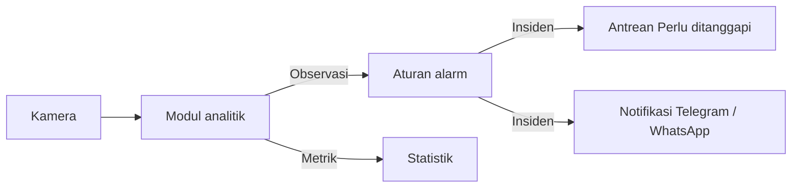

JagaInd mengubah kamera CCTV yang sudah terpasang menjadi kamera yang mengenali kejadian. Modul analitik mengamati video, aturan alarm memutuskan kejadian mana yang perlu ditanggapi, dan petugas menerima insiden lengkap dengan bukti visual.

Semua pemrosesan berjalan di server lokal (server edge) di lokasi Anda. Anda membuka dashboard JagaInd lewat peramban di jaringan lokal, tanpa perlu koneksi internet. Internet hanya dibutuhkan bila Anda memakai notifikasi Telegram atau WhatsApp.

## Mulai dari peran Anda

<Columns cols={2}>
  <Card title="Saya admin atau teknisi" icon="wrench" href="/mulai/panduan-cepat-admin">
    Tambahkan kamera, pasang modul analitik, gambar garis atau area, lalu buat aturan alarm.
  </Card>
  <Card title="Saya operator atau petugas jaga" icon="monitor" href="/mulai/panduan-cepat-operator">
    Pantau kamera, tanggapi insiden yang masuk, dan periksa riwayat insiden.
  </Card>
</Columns>

## Tugas yang sering dilakukan

<Columns cols={3}>
  <Card title="Menambah kamera" icon="camera" href="/kamera/cara-menambah-kamera">
    Hubungkan kamera RTSP atau coba dengan kamera uji.
  </Card>
  <Card title="Memasang modul" icon="boxes" href="/modul/cara-memasang-modul">
    Pilih apa yang dikenali kamera dan gambar area pengawasannya.
  </Card>
  <Card title="Membuat aturan alarm" icon="sliders-horizontal" href="/aturan/cara-membuat-aturan-alarm">
    Tentukan kapan kejadian menjadi insiden dan seberapa penting.
  </Card>
  <Card title="Menanggapi insiden" icon="shield-alert" href="/pemantauan/cara-menanggapi-insiden">
    Akui insiden di antrean Perlu ditanggapi.
  </Card>
  <Card title="Mengelola pengguna" icon="users" href="/akun/cara-mengelola-pengguna">
    Tambahkan akun dan atur perannya.
  </Card>
  <Card title="Mengirim notifikasi" icon="bell" href="/notifikasi/cara-kerja-notifikasi">
    Kirim insiden ke Telegram atau WhatsApp.
  </Card>
</Columns>

## Cara kerja JagaInd

1. **Kamera** mengirim video ke server JagaInd.
2. **Modul analitik** mengamati video dan mencatat kejadian, misalnya orang melewati garis. Kejadian ini disebut observasi.
3. **Aturan alarm** menentukan observasi mana yang menjadi **insiden**, berdasarkan jenis kejadian, jadwal, tingkat keyakinan AI, dan jeda antar alarm.
4. **Insiden** masuk ke antrean petugas di layar Pantau dan dapat dikirim sebagai notifikasi.

Modul statistik, seperti Penghitung Pengunjung, tidak membuat insiden. Hasilnya tampil sebagai grafik.

Pelajari istilah lengkapnya di [Konsep dasar](/mulai/konsep-dasar).
